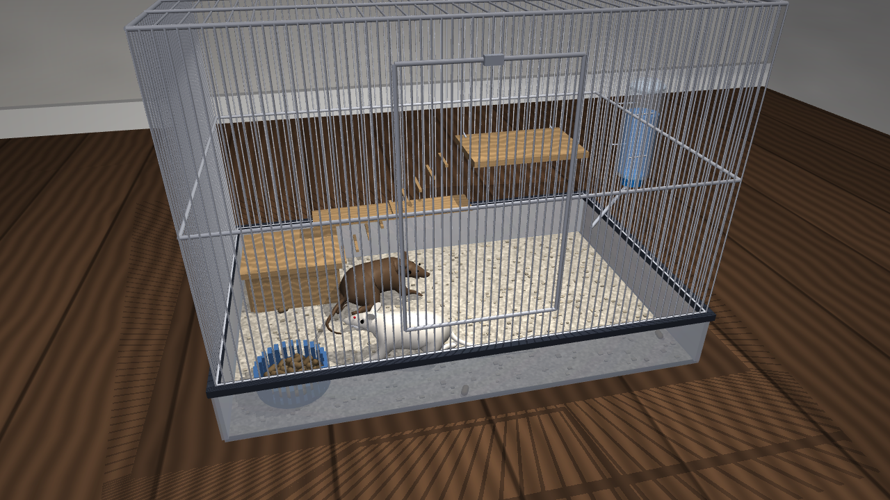
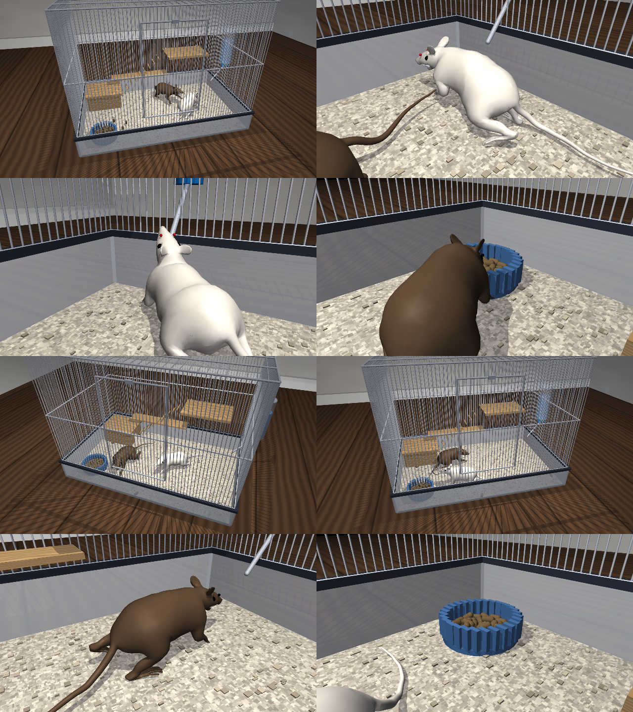

# Virtual Rat Home Cage (MuJoCo)

Two anatomically modelled rats living in a realistic pet/lab-style home cage,
simulated with the [MuJoCo](https://mujoco.org) physics engine.





## What's inside

| File | Purpose |
|---|---|
| `build_scene.py` | Builds the cage, room, water bottle, pellet bowl, furniture and attaches two rats (MjSpec). Run it to export `rat_cage_scene.xml`. |
| `rat_controller.py` | Locomotion (CPG + inverse kinematics gait) and behaviour (explore / sniff / drink / eat) controllers. |
| `simulate.py` | Runs the simulation and renders an MP4 with an automatic camera director, or opens the interactive viewer. |
| `assets/rodent.xml`, `assets/rodent_walker_skin.skn` | The rat body: DeepMind's *virtual rodent* (dm_control, Apache-2.0). |
| `media/rat_cage.mp4` | Rendered 45 s video. |
| `screenshots/` | Stills captured while building and from the video. |

## The rat

The body is the **DeepMind virtual rodent** (Merel et al., *Deep neuroethology
of a virtual rodent*, ICLR 2020), built from measurements of a Long-Evans rat:

* mass 0.34 kg, nose-to-tail-tip ≈ 30 cm
* 67 joints (spine, neck, 30-segment tail, jaw, four legs), 38 position actuators
* skinned surface mesh driven by the skeleton, plus capsule collision geometry

Two copies are loaded: `rat1` (albino, red eyes) and `rat2` (agouti brown).
The model's own overhead tracking light is removed and small eyeballs are added
because the skin mesh has none.

## The cage

Proportions follow typical commercial enclosures recommended for a pair of
adult rats (e.g. 80 × 50 × 80 cm "rat / ferret" cages; guideline ≥ 2.5 ft³ of
space per rat, 1/2-inch bar spacing).

| Property | Value |
|---|---|
| Floor | 80 cm × 50 cm (≈ 4 body-lengths × 2.5 body-lengths) |
| Height | 60 cm (10 cm deep plastic base pan + 50 cm wire top) |
| Volume | 0.24 m³ ≈ 8.5 ft³ (≈ 4.2 ft³ per rat) |
| Bars | 2.5 mm wire, 1.25 cm spacing, front door with latch |
| Floor covering | paper-pellet bedding |

**Water section**: a 500 ml gravity bottle clipped to the outside of the
right-hand wall, with a stainless sipper tube and ball tip poking through the
bars at nose height (8.5 cm).

**Pellet section**: a heavy glazed ceramic bowl in the front-left corner with
~45 rodent-chow pellets, each simulated as its own rigid body (the rats can
nudge them about); a few pellets are scattered on the bedding.

Furniture: wooden hide house (back-left), a wooden shelf on the back wall and a
ramp up to it.

## How the rats move

`rat_controller.py` has three layers:

1. **GaitLibrary**: for each leg, the paw path over one stride (sweep back
   along the ground during stance, lift and swing forward during swing) is
   turned into joint angles by damped-least-squares inverse kinematics on the
   real rat skeleton. Stride length and paw lift are stored separately so
   stride can scale with speed while the paws always clear the bedding.
2. **RatController**: a central pattern generator running a lateral-sequence
   walk (LH → LF → RH → RF) at 3.5 Hz, like a real rat. It steers with
   uneven left/right strides plus spine and neck bending, swings the tail,
   sniffs (7.5 Hz head bob), licks the spout (~7 Hz jaw) and chews (~5 Hz).
   Joint targets are converted into commands for the model's position
   actuators.
3. **Behaviour**: a small ethogram-style state machine with explore
   (random waypoints, avoids walls, furniture and the other rat), sniff/rear,
   thirst-driven *go to water → drink* and hunger-driven
   *go to food → eat*.

**Realism note:** in the dm_control paper this body is driven by a trained
neural-network policy. Here it uses a hand-built gait, so two aids are
added: (a) the limb servos are made 3× stiffer and faster, so joints follow
the gait; (b) a light **postural assist** applies an external force and
torque to the torso, standing in for the balance reflexes a trained policy
would provide. That assist keeps the torso upright, carries 35 % of body
weight and adds a heading-correction torque. It applies **no forward
force**: walking speed (~15 cm/s at full stride) comes only from paw–ground
contact. You can change the assist with `RatController(..., assist=...)` or
its `support`, `kh` and `push` attributes.

## Running

```bash
pip install mujoco imageio imageio-ffmpeg numpy
# headless video (uses EGL; use MUJOCO_GL=osmesa if no GPU/EGL)
MUJOCO_GL=egl python simulate.py --seconds 45 --out media/rat_cage.mp4
# interactive viewer
python simulate.py --viewer
# export the full scene as MJCF
python build_scene.py
```

Rendering uses 4 worker processes (`--workers`). Physics runs at about real
time on a laptop CPU; rendering with soft shadows takes longer.

## Credits

Rat model © DeepMind Technologies, from
[google-deepmind/dm_control](https://github.com/google-deepmind/dm_control),
licensed under the Apache License 2.0. Everything else (cage, controllers,
textures) was written for this project.
