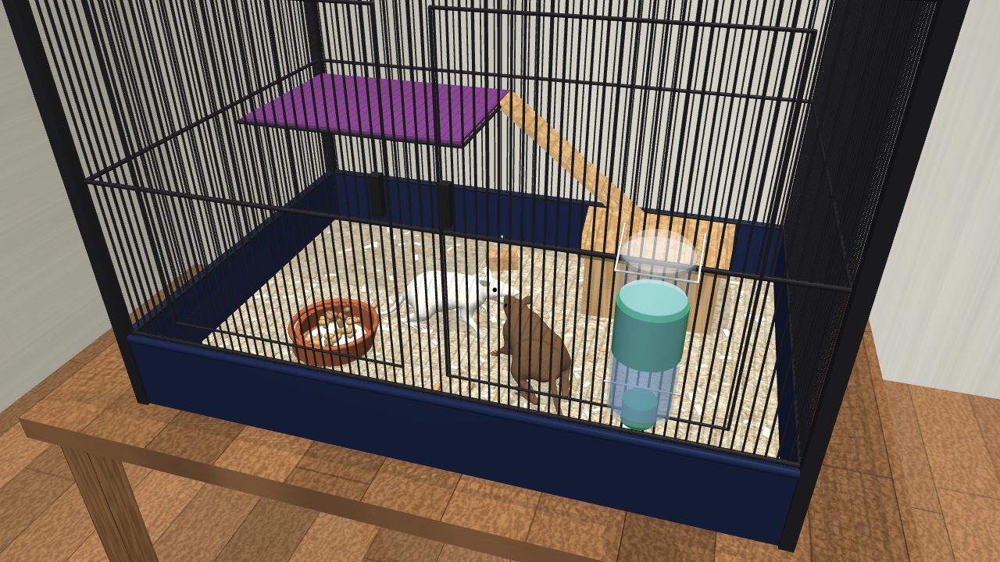

# Virtual rat cage: two rats in MuJoCo

A physically simulated rat enclosure built in [MuJoCo](https://mujoco.org).
It contains two anatomically modelled rats that walk around, drink from a
gravity water bottle, eat lab-chow pellets from a ceramic bowl, rear up
against the bars and groom.



## The cage

The cage is modelled on a common commercial two-rat cage (one level of a
Critter-Nation-style unit). Its proportions to the rats match real housing.

| Item | Model | Real reference |
|---|---|---|
| Interior | 91 × 61 × 63 cm (L × D × H) | 36" × 24" × 25" single unit |
| Floor area | 0.56 m² | recommended ≥ 0.23 m² for 2 rats |
| Volume | ≈ 0.35 m³ (12 ft³) | ≥ 2.5 ft³ per rat |
| Bar spacing | 1.27 cm (½") | ½" for adult rats |
| Base pan | 12 cm deep plastic pan + paper bedding | 5" deep pan |
| Rat body | ≈ 22 cm nose to rump + tail, 338 g | adult Long-Evans rat |

The cage is about 4 body-lengths long and 2.8 body-lengths deep.

**Contents**
* **Water section**: a 500 ml bottle hangs on the outside of the front bars.
  A stainless sipper tube with a ball tip reaches in about 8 cm above the bedding.
  The bottle has a cap, a label, a visible water level and a drop at the tip.
  The rats stretch up to it and lick at about 7 Hz.
* **Pellet section**: a heavy ceramic crock (13 cm), built from tilted wall
  segments so it is actually concave. It is filled with 26 lab-block pellets,
  each one a free rigid body, and 5 more pellets are scattered in the bedding.
  A rat puts its head into the bowl and takes a pellet. It then sits up on its
  haunches, holds the pellet in both forepaws and nibbles it; the pellet
  shrinks as it is eaten.
* Wooden hideout house, wire half-shelf with a fleece liner and a slatted ramp,
  a wooden chew block, double front doors with latches, and a 12 cm deep pan.
* The room: a table, a wood floor, painted walls and three lights.

## The rats

Each rat is DeepMind's **virtual rodent**, the anatomical rat model from
Merel et al., *Deep neuroethology of a virtual rodent* (ICLR 2020), shipped
with `dm_control`. It has a full skeleton (spine, tail and neck vertebrae,
scapulae, limbs, jaw), 67 joints, 38 muscle-like actuators and a skinned body
mesh. This project adds:

* cylindrical UV coordinates to the skin (`skin_uv.py`) so that procedural
  fur textures can be applied. One rat is albino and one is agouti/brown.
* a free joint so each rat can move around the cage.

## How the rats move (`rat_controller.py`)

There is no trained neural network. The controller is a hand-built hierarchy:

1. **Behaviour state machine**: explore, walk to a goal, drink, eat, rear,
   groom, idle. Thirst and hunger build up over time, and the rats take turns
   at the bottle and the bowl. Navigation steers around obstacles and the other
   rat; if a rat gets stuck it backs off and picks a new goal.
2. **Gait pattern generator**: a lateral-sequence walk at low speed and a
   diagonal trot at higher speed. Stride frequency rises from 2.6 to 6 Hz with
   speed, as in real rat gait data.
3. **Leg inverse kinematics**: paw trajectories (stance plus swing with lift)
   are turned into hip/knee/ankle and shoulder/elbow/wrist angles through IK
   tables solved on the model at start-up, around a crouched nominal stance.
4. **Postures**: head pitch and yaw, sniffing bobs, whole-body sitting and
   rearing, forepaws to the mouth (also solved with IK), chewing and licking
   with the jaw, and tail sway.
5. **Postural assistance**: a gentle external force and torque on the torso
   and pelvis provides balance and heading. A learned balance policy does this
   job in the original research. The paws still make real frictional contact
   and carry part of the weight, and the body, pellets and bowl are all
   simulated dynamically.

## Running

```bash
pip install -r requirements.txt
python simulate.py --seconds 45 --out media/rat_cage.mp4 --shots screenshots/sim
python simulate.py --viewer        # interactive viewer (needs a display)
python snap.py screenshots/still   # static renders from every camera
```

Headless rendering uses EGL (`MUJOCO_GL=egl`). On a machine without EGL,
use `MUJOCO_GL=osmesa`.

## Files

| File | Purpose |
|---|---|
| `cage.py` | Builds the cage and room (MJCF generated from Python) and attaches the two rats with `MjSpec` |
| `rat_controller.py` | Gait CPG, leg IK, postures, balance assistance, behaviours, pellet handling |
| `simulate.py` | Simulation loop, camera director, MP4 and screenshot rendering |
| `textures.py` | Procedural textures: wood, paper bedding, wall paint, fur |
| `skin_uv.py` | Adds UV texture coordinates to the rat skin |
| `snap.py` | Still renders from every camera |
| `assets/` | Rat model and skin from dm_control (Apache-2.0, see `assets/LICENSE_dm_control`) |
| `media/rat_cage.mp4` | Rendered video |
| `screenshots/` | Screenshots taken while the project was built and during the simulation |

## Credits

The rat model (`assets/rodent.xml`, `assets/rodent_walker_skin.skn`) comes
from [dm_control](https://github.com/google-deepmind/dm_control), Apache
License 2.0, © DeepMind. All other code and textures were written for this
project.
